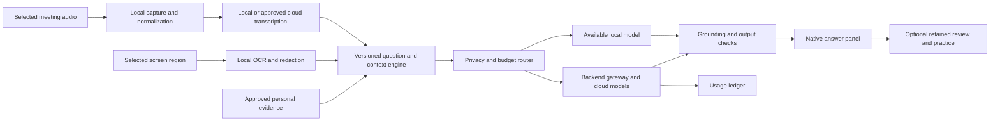

# macOS interview assistant — product and engineering master plan

Planning date: 6 October 2026 · Version 1.0 · Planning document only

**Recommendation:** build a native Mac application that understands selected screen content and conversation audio, retrieves the candidate’s verified experience, and produces concise, evidence-linked assistance. Combine interview preparation, permitted live assistance, and post-session learning. Keep capture, text extraction, redaction, and as much transcription as practical on the device; purchase cloud reasoning only when it materially improves the answer.

The intended advantage is **better assistance per dollar, fewer invented personal claims, reliable Mac integration, and measurable improvement in interview skills**. Those are testable. “Undetectable,” “uncatchable,” “100% correct,” “guaranteed job offer,” and “features nobody has ever invented” are not defensible promises. This plan includes ambitious research ideas but does not claim worldwide novelty. It does not include proctoring bypass, process concealment, recording-indicator suppression, covert remote operators, or automatic submission of answers in restricted assessments.

Live answer assistance is designed for practice, accessibility arrangements, and interviews that permit it. A compact interface and private storage are useful product features; they do not guarantee that another person or recording cannot observe the application. No claims about legality across jurisdictions are made here.

## How to use this document

Read sections 1–4 for the product decision, 5–15 for implementation detail, 16–18 for costs and execution, and 19–24 for experiments, launch criteria, and unresolved decisions. Every unproven performance number is a **target**, every proposed price is a **hypothesis**, and vendor facts are linked to sources. The detailed feature list is a roadmap, not a commitment to ship every feature in the first release.

### Contents

- [1. Working assumptions and the first market](#1-working-assumptions-and-the-first-market)
- [2. Competitive strategy and what “better” means](#2-competitive-strategy-and-what-better-means)
- [3. Modes and the assistance contract](#3-modes-and-the-assistance-contract)
- [4. Feature inventory with priorities](#4-feature-inventory-with-priorities)
- [5. End-to-end user experience](#5-end-to-end-user-experience)
- [6. Architecture and technology decisions](#6-architecture-and-technology-decisions)
- [7. Audio pipeline in implementation detail](#7-audio-pipeline-in-implementation-detail)
- [8. Screen understanding in implementation detail](#8-screen-understanding-in-implementation-detail)
- [9. Answer generation, grounding, and verification](#9-answer-generation-grounding-and-verification)
- [10. Personal memory, document ingestion, and data design](#10-personal-memory-document-ingestion-and-data-design)
- [11. API and event contracts](#11-api-and-event-contracts)
- [12. macOS permissions, distribution, and accessibility](#12-macos-permissions-distribution-and-accessibility)
- [13. Privacy, security, and retention](#13-privacy-security-and-retention)
- [14. Performance, reliability, and failure behavior](#14-performance-reliability-and-failure-behavior)
- [15. Evaluation and quality assurance](#15-evaluation-and-quality-assurance)
- [16. Model costs and cost optimization](#16-model-costs-and-cost-optimization)
- [17. Pricing, commercial model, and development budget](#17-pricing-commercial-model-and-development-budget)
- [18. Delivery roadmap, staffing, and decision gates](#18-delivery-roadmap-staffing-and-decision-gates)
- [19. Advanced research program](#19-advanced-research-program)
- [20. Scale, operations, and launch](#20-scale-operations-and-launch)
- [21. Risk register and scope controls](#21-risk-register-and-scope-controls)
- [22. Concrete example session](#22-concrete-example-session)
- [23. Decision register before implementation](#23-decision-register-before-implementation)
- [24. Source and verification notes](#24-source-and-verification-notes)

## 1. Working assumptions and the first market

### 1.1 Initial audience

Assume the initial customer is a software engineer preparing for behavioral, coding, debugging, and system-design interviews. Include English-first interaction, with Hindi/English code-switching as an explicit later evaluation track. Expand to product management, data, sales, finance, and general professional interviews only after the core system is reliable. The user has not specified an initial audience, team size, or budget; these are planning assumptions to revisit, not established requirements.

The initial buyer is an individual candidate. Interview coaches and training organizations are a second channel. Building employer hiring recommendations or automated candidate scoring is outside this product’s first scope and would require a separate assessment of product, fairness, and compliance requirements.

### 1.2 Supported machines

- **MacBook, iMac, Mac mini, Mac Studio, and Mac Pro:** one macOS product; no separate iMac application.
- **Proposed deployment baseline:** macOS 15 or later, subject to a two-week compatibility spike. Avoid dependence on newly announced APIs for the baseline.
- **Primary qualification tier:** Apple Silicon, 16 GB RAM, a supported macOS release. Test an entry-level supported machine, not just a developer’s expensive Mac.
- **Constrained tier:** supported 8 GB Macs use smaller local models or cloud transcription. Monitor memory pressure during an actual video call.
- **Intel iMac and other Intel Macs:** support compatible OS/hardware combinations through a separately qualified hybrid/cloud tier. Do not promise Apple Intelligence or the same local-model speed. Publish the exact supported models/OS combinations after testing.
- **Older unsupported macOS:** preparation through exported study material remains possible, but do not advertise native live compatibility that has not been implemented and tested.
- **No Windows, Linux, mobile companion, or browser-only client in the initial roadmap.** A website for accounts, payment, and documentation does not expand the assistant’s supported platforms.

Use runtime capability checks for individual APIs and model availability. “Runs macOS” does not imply that a particular on-device language or speech model is installed, enabled, supported, or available in the user’s language.

### 1.3 Product principles

1. Capture only selected content and clearly display what is active.
2. Separate what the interviewer said, what the screen shows, and what the model inferred.
3. Give a useful short answer before optional depth.
4. Ground personal stories in user-confirmed experience.
5. Stop or degrade safely when permissions, context, connectivity, or budget are missing.
6. Keep the candidate in control of what they say, copy, execute, or share.
7. Price with understandable hours and explicit premium allowances.
8. Evaluate with realistic Mac workloads, accents, question changes, and network failures.

## 2. Competitive strategy and what “better” means

Do not start by cloning every competitor button. Build one complete experience: **prepare → rehearse → receive permitted help → understand mistakes → rehearse again**. A long feature list without low latency, correctness, and a clear interface will perform poorly in a stressful conversation.

### 2.1 Proposed measurable advantages

- **Personal accuracy:** suggested personal claims link to approved résumé or story evidence. The application identifies gaps instead of inventing achievements.
- **Context accuracy:** answers identify the specific current question, visible code, diagram, or table and update when that context changes.
- **Low cognitive load:** a one-sentence opening and three key points appear first; detail remains expandable.
- **Predictable spending:** the user sees remaining cloud time and premium allowance; a session does not incur an unexplained charge.
- **Privacy choice:** fully local compatible modes and a visible inventory of what cloud assistance will send.
- **Mac reliability:** selection, permission changes, AirPods reconnects, external-display changes, sleep, and full-screen windows are treated as ordinary product cases.
- **Learning transfer:** users improve on a later unaided mock, not just while reading suggestions.

These become superiority claims only after a fair comparison using equivalent workloads and published methodology. Until then, describe them as design goals.

### 2.2 Comparison protocol

Use 100–200 matched, synthetic or consented scenarios, including behavioral, coding, system design, and screen-heavy questions. Match language, question, résumé, hardware, network, and relevant paid tier. Test the default settings a normal user receives; also publish any tuned settings. Rotate tool order to reduce learning effects.

Have qualified reviewers score anonymized outputs on correctness, relevance, evidence support, concision, and usefulness. Measure time from the same reference event, not from different UI events in each product. Include total price for a one-week intensive search, four sessions in a month, and an extended search; annual advertised monthly equivalents are not monthly cancellation prices.

Publish win/tie/loss counts, uncertainty intervals, sample sizes, failure cases, and cost per completed session. Do not equate a larger model, more tokens, or more features with a better candidate experience.

## 3. Modes and the assistance contract

### 3.1 Preparation mode

Import résumé and job description; confirm personal facts; build a story library; diagnose skill gaps; research a company from approved public sources; create a time-bounded study plan. No live recording permissions are required for basic preparation.

### 3.2 Mock interview mode

An AI interviewer conducts role-appropriate sessions. Choose hints, delayed feedback, or unaided assessment. Provide standard synthetic interview voices; no imitation of a real interviewer without authorization. Camera feedback is optional, separate from the core product, and limited to observable presentation factors rather than unsupported emotion or personality inference.

### 3.3 Permitted live assistance

The user selects the meeting audio and relevant window, confirms the permitted scope, and receives suggested answers. Distinguish transcription, screen analysis, answer drafting, and recording retention as separate switches. A saved permission statement records the user’s understanding; it does not prove another party’s consent or override an interview’s rules.

If the user knows AI help is prohibited, live answer generation should be unavailable for that session. Preparation remains available. Do not infer permission merely because a platform can be captured.

### 3.4 Accessibility/caption mode

Offer large captions, adjustable reading speed, keyboard navigation, reduced motion, and transcript clarification. Accessibility arrangements may permit captions but not generated answers. Represent that distinction explicitly in session settings instead of assuming one permission covers both.

### 3.5 Review mode

With saved material the user chose to retain, show missed constraints, weak examples, alternative structures, and practice drills. Allow editing and deletion of transcripts and personal facts. Provide no unsolicited messages to interviewers or recruiters.

## 4. Feature inventory with priorities

**P0:** required for a dependable first paid product. **P1:** next after P0 evidence. **P2:** expansion after core economics and quality are established. **R:** research experiment with a go/no-go gate. Dependencies matter more than the sheer count.

### 4.1 Candidate and preparation workspace

- **F01 · P0 — Résumé import:** PDF/DOCX/plain text, explicit preview, extraction diagnostics, document version, and deletion. A scanned PDF uses opt-in OCR; unsupported or encrypted files produce a clear message.
- **F02 · P0 — Fact confirmation:** propose employment dates, responsibilities, tools, and achievements; user approves or corrects them before the answer engine treats them as verified.
- **F03 · P0 — Job-description mapping:** identify required skills and evidence already available; distinguish quoted requirements from inferred expectations.
- **F04 · P0 — Story library:** store situation, task, action, result, lessons, ownership, and source for each example. Do not fabricate a quantified result when the source has none.
- **F05 · P0 — Interview setup:** role, seniority, stage, duration, language, target skills, permitted assistance, and a target-scoped saved context pack. Retrieval must enforce the active target ID; test with unrelated facts planted in another target.
- **F06 · P1 — Company brief:** public information with URLs and retrieval dates; conflicting or stale information remains labeled.
- **F07 · P1 — Study plan:** schedule exercises around the user’s available days and weakest skills, with a clear revision rule after each mock.
- **F08 · P1 — Experience contradiction checker:** flag inconsistent dates, changing metrics, or confusing personal versus team ownership for human correction.
- **F09 · P1 — Answer length practice:** practice the same truthful example in 30-, 60-, and 120-second forms.
- **F10 · P2 — Portfolio evidence:** user-selected project files, public repositories, diagrams, and case studies; default to read-only ingestion with provenance.
- **F11 · P2 — Career transition mapping:** explain how existing skills transfer to a target role without inventing domain experience.
- **F12 · P2 — Multiple profiles:** separate candidate personas and private profile libraries. One candidate’s separate applications/InterviewTargets and context isolation already belong to F05/P0.

### 4.2 Audio and conversation understanding

- **F13 · P0 — Meeting audio capture:** capture the selected permitted source with a level meter and explicit status.
- **F14 · P0 — Optional microphone channel:** capture the candidate separately when needed; microphone denied does not prevent system-audio-only workflows.
- **F15 · P0 — Live transcript:** distinguish provisional and final segments and preserve timestamps and corrections.
- **F16 · P0 — Question detection:** recognize questions, prompts, corrections, and requests for examples; offer a manual trigger when automatic detection misses.
- **F17 · P0 — Follow-up memory:** resolve “why that choice?” against the current discussion, while allowing manual question correction.
- **F18 · P0 — Transcript correction:** edit a mistaken technical term and update the active question without rewriting historical source audio.
- **F19 · P1 — Vocabulary pack:** company names, acronyms, libraries, and personal project names; measure whether biasing improves names without increasing false matches.
- **F20 · P1 — Speaker handling:** separate candidate versus remote audio where possible; label overlapping remote speakers as uncertain rather than claiming identity.
- **F21 · P1 — Code-switching:** evaluate English/Hindi and other selected language pairs with real bilingual reviewers before advertising them.
- **F22 · P0 — Audio recovery:** selected-device reconnect, missing-audio notice, input selection, and explicit transcript-gap markers. Optional replay of a permitted short buffer is P1.
- **F23 · P2 — Translation:** preserve original text, translated meaning, and uncertain technical terms; do not promise equivalent latency or quality in every language.
- **F24 · P2 — Observable delivery coaching:** speaking pace, long pauses, filler patterns, and interruptions in practice; configurable because speech differences are not competence scores.

### 4.3 Screen and visual context

- **F25 · P0 — Selected-window analysis:** source picker, preview, visible active source, and immediate pause.
- **F26 · P0 — Local text extraction:** OCR with text boxes and confidence; use explicit user selection to resolve ambiguous regions.
- **F27 · P0 — Question-region capture:** analyze only the relevant prompt/code region when the user selects it.
- **F28 · P0 — Freshness indicator:** attach a timestamp to screen context and flag closed, minimized, stale, blank, or replaced sources.
- **F29 · P0 — Change detection:** update context when meaningful content changes; do not resend the same frame continuously.
- **F30 · P1 — Code structure:** preserve indentation, line breaks, syntax, and visually ambiguous characters; mark uncertain operators or constraints for confirmation.
- **F31 · P1 — Diagram understanding:** identify entities and relationships, then ask for clarification when connectors are unclear.
- **F32 · P1 — Table/chart reasoning:** preserve headers, units, axes, legends, and dates; require those before giving numerical conclusions.
- **F33 · P0 — Safe display changes:** maintain the chosen source or pause when displays change; never silently capture another display. Advanced multi-display workspace controls are P1.
- **F34 · P0 — Safe image upload:** crop/preview and mask selected sensitive regions before upload; text redaction alone does not redact pixels. Automated redaction suggestions and reusable region rules are P1.
- **F35 · P2 — Whiteboard iteration:** compare two approved snapshots and explain changed assumptions or flows.
- **F36 · P2 — Visual explanation export:** create user-reviewed explanatory diagrams for study notes; no automatic manipulation of the interviewer’s shared board.

### 4.4 Answer assistance

- **F37 · P0 — Short-first answer:** opening sentence, three useful points, and optional deeper detail.
- **F38 · P0 — Personal grounding:** evidence-linked examples; unsupported experience is presented as missing information, not a plausible invented story.
- **F39 · P0 — Answer controls:** shorter, expand, explain, clarify, use another example, and regenerate with a specific correction.
- **F40 · P0 — Question correction:** display the interpreted question and let the candidate fix it before generating another answer.
- **F41 · P0 — Uncertainty cues:** factual support and context completeness labels, rather than a fabricated numerical confidence score.
- **F42 · P0 — Stale-answer cancellation:** a new question or source revision cancels outdated generation and prevents late answers from replacing current ones.
- **F43 · P1 — Behavioral structure variants:** add CAR and conversational variants. One basic truthful STAR outline is part of the P0 answer and mock workflow.
- **F44 · P1 — Follow-up preparation:** one or two plausible next questions and what evidence to have ready; not a claim to predict the interviewer.
- **F45 · P1 — Answer consistency:** detect contradictions within the session and with approved personal facts.
- **F46 · P1 — Numerical checks:** validate units, arithmetic, order of magnitude, and assumptions with deterministic tools.
- **F47 · P1 — Clarification prioritization:** ask one high-value clarifying question when missing context would change the solution.
- **F48 · P2 — Style adaptation:** adapt verbosity and terminology to the user’s preferred communication style, without voice impersonation or deceptive identity claims.

### 4.5 Technical interview modules

- **F49 · P0 — Coding approach:** restate constraints, propose an approach, explain complexity, and identify edge cases.
- **F50 · P0 — Code explanation:** explain visible or pasted code; explicitly flag unreadable or incomplete input.
- **F51 · P1 — Candidate code critique:** find defects and propose a minimal change; distinguish verified execution results from unexecuted suggestions.
- **F52 · P1 — Isolated test runner:** run only user-approved snippets in a restricted execution environment; no access to candidate files or network by default.
- **F53 · P1 — SQL assistance:** reason about joins, NULLs, duplicates, window functions, and dialect differences using an explicit schema.
- **F54 · P1 — System-design coach:** requirements, scale estimates, interfaces, storage, reliability, security, cost, and alternatives.
- **F55 · P1 — Debugging coach:** symptom, hypothesis, discriminating test, evidence, and smallest plausible fix.
- **F56 · P2 — Data and statistics:** state assumptions, sample sizes, uncertainty, and whether evidence supports causation.
- **F57 · P2 — Infrastructure and security:** design/troubleshooting practice with role-specific rubrics and safe isolated exercises.
- **F58 · P2 — Framework packs:** versioned reference packs for selected languages/frameworks; retrieval dates and source licenses maintained.
- **F59 · P2 — Product cases:** product goals, users, trade-offs, metrics, experiment design, and decision justification.
- **F60 · P2 — Sales/business cases:** discovery, objection handling, prioritization, and business arithmetic; no unsupported claims about the user’s track record.

### 4.6 Practice and learning

- **F61 · P0 — Basic mock interviewer:** text or voice, role-specific questions, timer, stop/resume, and a final review.
- **F62 · P0 — Unaided baseline:** begin with a no-hint exercise so improvement can be measured.
- **F63 · P1 — Adaptive difficulty:** adjust after demonstrated performance, not after accent or speaking speed.
- **F64 · P1 — Detailed rubric:** deepen correctness, structure, coverage, evidence, and clarity assessment; permit disagreement and correction. P0 mocks already need a simple explicit rubric and a useful final review.
- **F65 · P1 — Spaced practice:** revisit a missed skill after a delay with a different problem.
- **F66 · P1 — Replay and alternatives:** compare the user’s retained answer with a better-supported alternative and the reasons for the changes.
- **F67 · P1 — Progressive hints:** start with a nudge before revealing an approach or full solution.
- **F68 · P2 — Panel simulation:** different question styles and follow-ups, without pretending to reproduce a named real person.
- **F69 · P2 — Coach workspace:** user-approved sharing, revocable access, private notes, and separation between personal and shared data.
- **F70 · P2 — Role progression:** track evidence of skill growth across junior, mid-level, senior, and staff expectations.
- **F71 · P2 — Take-home rehearsal:** planning, self-review, and explaining choices using synthetic or authorized assignments.
- **F72 · P2 — Interview-question library:** licensed/publicly permitted or original questions with tags, difficulty, source, and update history.

### 4.7 Mac experience, controls, and commercial features

- **F73 · P0 — Native compact panel:** adjustable font and size, selectable placement, preserved keyboard focus, and a clearly visible capture status.
- **F74 · P0 — Keyboard operation:** discoverable, configurable actions with shortcut-conflict checks and no dependence on mouse precision.
- **F75 · P0 — Preflight:** permissions, source availability, audio meter, network, model readiness, memory, and remaining allowance.
- **F76 · P0 — Pause/stop:** explicit control stops collection and invalidates pending content, rather than merely hiding a panel.
- **F77 · P0 — Session budget:** show estimated cloud usage, reserve allowance before starting, and define interruption behavior.
- **F78 · P0 — Privacy settings:** local/hybrid choice, cloud provider disclosure, retention choices, export, and deletion.
- **F79 · P0 — Offline fallback:** display saved notes and any ready local capability; never silently upload after local-only was chosen.
- **F80 · P0 — Diagnostics:** content-free logs by default; a user previews any optional diagnostic bundle.
- **F81 · P0 — Secure accounts and billing:** device sessions, subscription state, usage ledger, invoices, cancellation, and refund policy.
- **F82 · P0 — Signed installation/update:** documented permissions, verified releases, staged rollout, and safe update timing.
- **F83 · P0 — Required model assets:** supported locale, readiness, size/disk checks, license, verified downloads, recovery, and deletion for any local engine used by P0. An optional model catalog and advanced selection are P1.
- **F84 · P0 — Core accessibility:** VoiceOver, Full Keyboard Access, high contrast, reduced motion, non-color status cues, and scalable core layouts. Additional personalized reading modes are P1.
- **F85 · P1 — Rich exports:** PDF and additional presentation formats with preview. A basic machine-readable user-data export and readable notes export are P0 under F78.
- **F86 · P1 — Bring-your-own-key:** optional advanced setting after core support costs are understood; explicit provider charges and local Keychain storage.
- **F87 · P2 — Encrypted synchronization:** optional, separately specified key management and conflict resolution; do not promise end-to-end encryption if servers need plaintext.
- **F88 · P2 — Organization controls:** permissions, retention configuration, seat management, and administrative logs without default access to private candidate material.

### 4.8 Research candidates

- **F89 · R — Personal evidence graph:** relate skills, project facts, story claims, and supporting artifacts; test whether it reduces invented or mismatched claims.
- **F90 · R — Question-to-evidence coverage map:** expose which parts of a multi-part question have actually been answered.
- **F91 · R — Adaptive hint reduction:** reduce assistance as skill improves, optimizing unaided performance rather than dependency.
- **F92 · R — Value-of-information selector:** choose between a clarification, another screen crop, retrieval, or a larger model based on expected improvement and cost.
- **F93 · R — Counterfactual practice:** branch a mock at a difficult moment and try another approach; compare outcomes without claiming to predict real hiring decisions.
- **F94 · R — On-device meeting concept graph:** merge changing visual and spoken context into a compact, timestamped representation.
- **F95 · R — Answer fragility checks:** identify an assumption whose failure would change the answer and offer a concise caveat.
- **F96 · R — Privacy and cost receipt:** show which sources informed an answer, what left the device, and the measured charge, with an optional signed integrity record.

## 5. End-to-end user experience

### 5.1 First run

1. Explain preparation, practice, captions, and permitted live modes in plain language.
2. Allow preparation without microphone or screen permissions.
3. Import résumé; show extracted facts and ask for corrections.
4. Add a target role/job description and choose an initial language.
5. Run a short hardware capability check; suggest a quality/cost preset without downloading gigabytes unexpectedly.
6. Offer a two-minute guided mock that teaches transcript correction, answer expansion, and pause.
7. Request each OS permission only when its feature is used. Explain denial recovery without repeated nagging.
8. Show privacy/retention defaults and distinguish local processing from cloud calls.

### 5.2 Before a live session

Choose an approved context pack and allowed assistance scope. Select the source window and audio. Run an audible/visible level check; verify actual incoming audio, not just device existence. Show model readiness, time allowance, network status, and a sample question. Require a session start action; selecting a calendar event alone must not begin capture.

Display the current scope as a short sentence, for example: “Captions and answer suggestions; selected meeting audio and coding window; hybrid processing; no saved recording.” A preflight green state means the tested inputs currently work, not that the application can predict every interview condition.

### 5.3 During a session

Use one main answer surface with four stable regions: interpreted question, short suggestion, evidence/assumptions, and optional expansion. Keep capture and cloud status visible but compact. Avoid animated reflow while the user reads; append stable blocks and label meaningful revisions. Let users pin a response for reading while later questions queue separately.

Never make every captured sentence generate an answer. Detect substantive questions and allow a manual “help with this” action. When context is insufficient, “I missed the constraint; confirm X” is preferable to a confident guess. If the answer is still generating, show a useful partial only if it has passed basic checks and remains relevant to the current question.

### 5.4 Stopping and reviewing

Stop capture and cancel generation immediately, then discard raw-media buffers according to policy and reconcile usage. Keep only the permitted in-memory transcript/answer draft for a short save-or-discard step, proposed maximum five minutes with a visible countdown; dismissal, expiry, app exit, or an explicit discard erases it. Do not silently stage it on disk. Save only the selected records. The review works from retained material; absence of a saved recording is not an error. Offer a three-part review: strongest answer, most important gap, and next practice exercise. More analytics live behind expansion.

### 5.5 Specific UI states

Design and prototype idle, downloading, permission-required, source-unavailable, ready, listening, question-detected, generating, answer-ready, paused, reconnecting, local-fallback, budget-low, budget-exhausted, and stopped. Every state needs readable text, keyboard focus behavior, allowed actions, timeout behavior, and a screen-reader announcement policy. Do not rely solely on a colored dot.

## 6. Architecture and technology decisions

### 6.1 Recommended shape

Build a **modular native desktop application and a small backend**, not a fleet of microservices. The desktop owns capture, permissions, local processing, context assembly, and the user interface. The backend owns authentication, entitlement checks, model access, usage accounting, and optional synchronization. Long review jobs use a worker queue rather than blocking the live session.

The diagram represents allowed data routes, not simultaneous use of every route. Local-only mode disables the cloud branch. Capture capability must be available even when the backend is unavailable; paid cloud inference still needs valid entitlement or an explicitly designed offline allowance.

### 6.2 Desktop stack

- **Swift + SwiftUI:** workspace, settings, onboarding, story library, practice, and review.
- **AppKit integration:** conventional window/panel behavior, focus, and platform details where SwiftUI alone is insufficient. Native integration is supported by Apple’s [AppKit integration documentation](https://developer.apple.com/documentation/swiftui/appkit-integration).
- **ScreenCaptureKit:** selected screen/system-audio capture, with separately handled microphone input and runtime availability checks. Apple supplies a [screen/audio capture sample](https://developer.apple.com/documentation/screencapturekit/capturing-screen-content-in-macos).
- **Vision:** local OCR; preserve text geometry and confidence. Apple documents [text recognition in images](https://developer.apple.com/documentation/vision/recognizing-text-in-images).
- **Speech adapters:** Apple Speech where supported, a licensed local engine where needed, and an approved cloud streaming provider.
- **SQLite-backed persistence:** transactional local records, indexed search, schema migrations, and explicit encrypted storage. Plain SQLite is not automatically an encrypted personal-data vault.
- **Keychain:** device secrets, refresh tokens, encryption keys, and optional user-owned API keys. See [Apple Keychain services](https://developer.apple.com/documentation/security/keychain-services).
- **Swift structured concurrency:** actors around mutable session state; background work for capture/OCR/inference; no heavy model work on the main UI thread.

Prefer this stack over Electron for the first Mac-only version because native capture, permissions, resource management, and accessibility are central requirements. This is a design trade-off, not a universal performance claim. If the team lacks native expertise, budget for it rather than hiding that cost in a web wrapper.

### 6.3 Backend stack

Use a small TypeScript service with typed request validation, PostgreSQL for accounts/billing/usage, an object store only for opted-in retained artifacts, and a worker process for exports/reviews. This is a recommended implementation choice, not a requirement for a particular cloud vendor. A team already strong in Go can choose Go without changing the contracts.

Start with one deployment region after measuring latency for the first customer geography and reviewing processing constraints. Keep development, staging, and production separate. Use managed secrets and database backups. Add Redis only if concrete needs such as distributed rate limiting, resumable ephemeral sessions, or worker coordination justify it; a queue abstraction need not immediately mean another paid service.

Use a persistent WebSocket for live event transport and HTTPS for account/configuration/exports. Do not proxy raw screen video through the backend. Prefer direct local OCR and small selected image requests. For cloud audio, the gateway can enforce controls while relaying transient buffers; evaluate scoped, short-lived provider credentials only where the provider supports them securely.

### 6.4 Module contracts

- **SessionCoordinator:** state transitions, stop/pause semantics, generation epoch, user-selected mode, capability registry.
- **CaptureManager:** source selection, start/stop confirmation, bounded screen and audio buffers, permission/source change events.
- **AudioPipeline:** format conversion, voice activity, clock mapping, dropped-buffer counters, device routing.
- **TranscriptionService:** partial/final segments, corrections, language, timings, provider health.
- **ScreenUnderstanding:** region text, source identity, bounding boxes, capture revision, image references, redaction status.
- **EvidenceStore:** imported documents, confirmed personal claims, source ranges, revision history, search indices.
- **ContextBuilder:** bounded context selection, provenance, session summary, recent turns, current constraints.
- **AnswerOrchestrator:** question type, deadlines, cancellation, output contract, verification policy.
- **ProviderRouter:** approved providers/models, capabilities, per-request budget, latency/cost metrics, fallbacks.
- **UsageService:** reservation, settlement, reconciliation, plan quota, refund adjustments.
- **ReviewWorker:** optional analysis, export, practice recommendations, and separate background budget.
- **Telemetry:** operational events with no raw personal content by default.

Keep those modules independently testable. Do not introduce an “agent” for every module: deterministic routing, retrieval, and validation should handle routine work.

## 7. Audio pipeline in implementation detail

### 7.1 Capture and normalization

Distinguish remote/system audio from the candidate microphone. The remote stream may contain several participants, notification sounds, and speaker leakage; it is not a guaranteed single named speaker. Capture only authorized sources and exclude the assistant’s own audio where supported.

Model visual and audio capture as separate selections. When the meeting and coding window belong to different applications, configure independent approved capture paths/streams and synchronize their clocks. ScreenCaptureKit audio filtering is application-scoped: selecting a browser window does not establish isolation to that tab/window, and other audible browser windows can be included. Explain the actual audio scope in preflight, test two simultaneously audible tabs, and verify behavior on every supported OS. See [Apple’s audio capture explanation](https://developer.apple.com/videos/play/wwdc2022/10155/).

Normalize each source to the format actually required by the selected speech engine, preserving timestamps and source identity. Do not hardcode a sample rate from a tutorial. Track original-to-normalized timing so speech and screen evidence can be aligned. Use a short bounded in-memory ring buffer; a proposed initial limit is 15–30 seconds, adjusted for the measured engine’s requirements and the chosen privacy mode.

Separate audio backpressure from video backpressure. Dropping obsolete screen frames is acceptable; silently dropping speech can remove the question’s key constraint. When speech cannot be processed within the buffer budget, report a transcript gap rather than invent continuity.

### 7.2 Speech activity and turn detection

Voice activity detection decides when audio probably contains speech; it does not reliably decide when an interview question is complete. Combine VAD with punctuation/semantic completion, a configurable trailing pause, and the transcript’s stability. Initially test 300–800 ms endpoint windows rather than selecting one universal delay.

Distinguish a brief pause inside a multi-part question from a completed prompt. Keep a manual trigger and an “add this follow-up” action. Measure premature answers separately from missed questions. Do not send every interim transcript revision to a reasoning model.

### 7.3 Local versus cloud transcription

Preflight installed locales and device support. Apple exposes speech analyzer/transcriber APIs and availability controls; those checks must determine the actual path rather than the product assuming a universal offline engine. See [SpeechAnalyzer](https://developer.apple.com/documentation/Speech/SpeechAnalyzer) and [SpeechTranscriber](https://developer.apple.com/documentation/speech/speechtranscriber).

Treat SpeechAnalyzer/SpeechTranscriber as a macOS 26+ route, with separate hardware, locale, and asset checks. The macOS 15 baseline needs a qualified alternative local engine or explicitly approved cloud transcription. Guard and weak-link newer APIs so the app still launches correctly on the minimum OS.

Evaluate one alternative local engine. The official [Argmax OSS Swift repository](https://github.com/argmaxinc/argmax-oss-swift) contains WhisperKit and documents its OSS requirements and licensing; commercial/pro features and model licenses must be assessed separately. Runtime memory, initial load time, and thermal load must be measured, not inferred from download size.

When local speech is inadequate, offer a tested cloud streaming route if the user enabled it. A cheap file-transcription API is not automatically a real-time speech engine. Route changes appear in the UI and respect the allowed provider list. Local-only settings never silently fall back to the cloud.

### 7.4 Transcript event behavior

Each segment carries session ID, stream ID, segment ID, start/end time, text, revision, finality, language, and uncertainty if the engine supplies a meaningful one. A correction replaces a prior revision, not a second transcript segment. Any question derived from corrected text records which revision was used.

Retain recent original transcript spans alongside a compact summary. Summaries must not become the sole source of truth, because they can drop negations, numeric constraints, or candidate ownership. A user correction should invalidate derived questions and answers that depended on the mistaken span.

### 7.5 Audio edge cases

Test speakers versus headphones; Bluetooth reconnect; USB removal; input/output default changes; muted conference output; silence; quiet/fast/accented speech; technical vocabulary; overlapping remote participants; noise; sample-rate changes; drift during two-hour calls; sleep; screen lock; and permission revocation. A microphone level meter alone cannot establish that the interviewer’s audio is being captured correctly.

## 8. Screen understanding in implementation detail

### 8.1 Capture contract

Use a supported source picker and retain the chosen source identity. Apple recommends its [system content-sharing picker](https://developer.apple.com/documentation/screencapturekit/sccontentsharingpicker). Begin with a selected window, not an entire desktop. Screen/system-audio permissions remain under normal [macOS privacy controls](https://support.apple.com/guide/mac-help/control-access-screen-system-audio-recording-mchld6aa7d23/mac).

Take an explicit initial snapshot; thereafter use modest capture frequency with change detection. Initial design target: roughly one frame per second for static questions, temporarily higher for a user-requested visual change. The capture stream may produce more frames internally; the processing/upload budget remains separate. Profile before fixing rates.

Use bounded queues; start with a small screen queue around three frames, then measure. Prefer the freshest complete frame. If the source closes or becomes unavailable, pause that input and ask the user to select it again. Never silently replace it with a full-display capture.

### 8.2 OCR and region processing

Map capture coordinates through window origin, content scale, Retina points/pixels, crop offset, and OCR coordinate conventions. Store normalized bounding boxes and the transform revision. Test negative-origin external displays and mixed scaling.

Run local OCR on meaningful changes. Preserve headings, code indentation, operators, table headers, and units. Ordinary spelling correction can damage code; evaluate it separately for code and prose. Low confidence on `<=` versus `<`, `0` versus `O`, or a complexity constraint deserves confirmation.

### 8.3 Sending images only when useful

OCR usually supplies textual questions more cheaply than a vision model call. Use images for diagrams, layouts, handwriting, charts, and uncertain text where visual evidence actually matters. Crop the relevant region, apply pixel redaction, cap resolution according to the model’s needs, and record the actual billed image tokens.

Hash/categorize changes locally to avoid resending the same screen. Do not rely on a perceptual hash alone for code: one changed operator can alter correctness despite a tiny visual difference. Combine image change signals with extracted text/constraint changes. A user can force a recapture when the detector misses something.

### 8.4 Staleness and versioning

Every screen-derived question has an evidence revision and capture time. If the interviewer changes “sorted” to “unsorted” or “one million rows” to “one billion,” invalidate the active context and cancel any dependent generation. Keep the old answer labeled as previous only if it remains useful for review.

A new visual question and an unrelated spoken comment must not be merged automatically. Keep source attribution visible: “from current screen,” “from interviewer audio,” and “assumption.” Protected, blank, off-screen, or unreadable content is unavailable; no workaround should be represented as reliable access.

## 9. Answer generation, grounding, and verification

### 9.1 Request pipeline

1. Stabilize or manually confirm the current question.
2. Classify its type and required capabilities using deterministic rules or a small evaluated classifier.
3. Retrieve relevant personal evidence and technical references.
4. Check whether missing context would materially change the answer.
5. Build a bounded context package with source IDs and current revisions.
6. Select the smallest evaluated model meeting the task’s quality bar and the user’s privacy/budget settings.
7. Generate into a structured incremental buffer that separates answer, evidence, assumptions, and optional detail.
8. Check complete sentences/blocks before display, including personal-claim support, evidence IDs, simple arithmetic, and applicable task rules. Deeper technical validation can produce a later labeled result; unsupported personal claims must not briefly appear and then retract.
9. Publish approved blocks only while the question revision and session epoch remain current. Include these pre-display checks in the time-to-useful-answer metric.
10. Meter actual usage; save the result only according to retention choices.

### 9.2 Suggested answer structure

The internal response contract contains `question_id`, `question_revision`, `short_answer`, `key_points`, `evidence_ids`, `assumptions`, `missing_information`, `optional_detail`, `verification_status`, and `model_run_id`. Technical artifacts such as code are separate from the spoken outline. The interface should not expose internal model-routing jargon unless it helps explain a limitation or cost.

Show evidence support levels such as “supported by your project note,” “general technical explanation,” or “needs confirmation.” Do not label a model’s self-reported probability as scientific confidence. If numerical confidence is introduced later, calibrate it on held-out labeled data and disclose what event it predicts.

### 9.3 Personal truthfulness

Never turn a job requirement into a claim of candidate experience. A résumé saying “worked with the payments team” does not establish “led the payments migration.” A model should not add revenue, team size, ownership, scale, or performance improvements without an approved source.

For a missing story, suggest a structure and a prompt for the candidate’s real example. Keep user-approved claims separate from extracted-but-unconfirmed text and from generated drafts. Editing the résumé invalidates dependent claims until reconciled.

### 9.4 Retrieval and context budget

Start with hybrid lexical plus semantic retrieval where it improves measured relevance. For a small story library, reliable keyword/tag retrieval may be enough; a vector database is not a prerequisite. If embeddings are used, index encrypted local material in a design that does not leave a plaintext shadow copy.

Prototype budget: approximately 6,000 input tokens per answer, divided among instructions/schema, approved personal facts, relevant evidence, current question/screen constraints, and a short recent conversation window. This is a cost-model assumption, not a claim that every interview fits. Trim low-value history first; never silently drop current numeric constraints to fit a budget.

### 9.5 Routing and escalation

Routine factual explanations, behavioral structuring, and summaries go to the economical route. Complex coding, ambiguous diagrams, difficult trade-offs, or failed checks may justify a stronger route. Do not generate an expensive second answer after every cheap answer. Try one controlled escalation when it has clear expected value.

Premium routing needs a deadline, output/reasoning budget, and cost reservation. Exhausting premium allowance should fall back to an explicitly labeled standard answer or clarification. Already-generated output can be billed even after cancellation; cancellation is not a refund guarantee.

### 9.6 Verification layers

- **Personal claims:** source existence and actual semantic support; not merely a plausible citation string.
- **Mathematics:** deterministic arithmetic with explicit units and assumptions.
- **Code:** parse/compile/test only in an approved isolated environment; otherwise label it unexecuted.
- **Complexity claims:** evaluate against the actual algorithm and constraints, not a stock response.
- **References:** links and dates checked during preparation; avoid slow speculative browsing on the live critical path.
- **Coverage:** compare answer points against each part of the question.
- **Uncertainty:** mark missing inputs and ambiguous readings; prefer a useful clarification to unsupported certainty.

The answer generator has no capability to send email, submit assessment answers, modify the interviewer’s environment, or run arbitrary commands on the user’s machine. This keeps suggestion failures from becoming external actions.

## 10. Personal memory, document ingestion, and data design

### 10.1 Ingestion process

User selects files → validate type/size → scan for malformed content → extract text in a constrained worker → show preview → segment by meaningful headings → propose claims → user confirms → index only approved content. Preserve original filename, version, hash, import time, source range, and user edits.

Proposed initial caps: 20 MB per document, 100 pages per PDF, 20 documents per profile, configurable after usage testing. Handle duplicate imports by content hash and version, not filename alone. Warn before extracting large image-heavy files. Do not fetch embedded document URLs automatically or execute macros.

### 10.2 Core records

- **ProfileDocument:** owner, file hash, version, type, import status, encrypted location, retention choice.
- **VerifiedClaim:** owner, claim text, category, supporting source/range, approval state, superseded-by link.
- **Story:** title, skill tags, situation/task/action/result/lesson, claim references, preferred length.
- **InterviewTarget:** job description version, role, company, stage, language, approved context pack.
- **Session:** mode, start/stop, device capability class, assistance scope, retention policy, price-policy version.
- **CaptureSource:** transient source identity, permission state, selected region, source revision.
- **TranscriptSegment:** stream, timestamps, text, revision, finality, gap markers.
- **ScreenEvidence:** capture timestamp, source revision, OCR regions, redaction state, optional image TTL.
- **Question:** text, category, transcript/screen references, revision, status.
- **Suggestion:** question revision, answer fields, evidence references, verification status, superseded flag.
- **ModelRun:** provider/model/version, request hash, timings, token usage, retry parent, outcome, price version.
- **UsageEntry:** reservation, settlement, user charge/quota impact, provider cost, adjustment reason, idempotency key.
- **ConsentPreference:** recording/cloud/sync/diagnostics choices and when the user changed them; avoid labeling this as proof of third-party permission.
- **DeletionJob:** requested scope, targets, progress, failures, completion receipts, provider limitations.

Use random IDs, UTC storage plus user-local display, server-authoritative billing times, and monotonic device clocks for media alignment. Index owner/session/time and enforce owner checks on every backend query. Separate analytics identifiers from content records.

### 10.3 Synchronization policy

Default to one-device local personal material. Accounts and cloud usage can exist without uploading the complete profile library. Send only necessary context fragments for opted-in cloud answers. Sync is a later independent feature with conflict resolution, key recovery, and deletion semantics specified before launch.

If end-to-end encrypted sync is offered, define where decryption happens, which keys servers do not have, and what recovery is possible. Cloud inference necessarily sees the material sent to it unless a separately verified confidential-processing mechanism applies. Do not describe an ordinary TLS connection as end-to-end encryption against the inference provider.

## 11. API and event contracts

### 11.1 External service interfaces

- `POST /v1/sessions`: start an entitled cloud session with mode, policy, capability summary, estimated duration, and idempotency key; returns session ID, scoped token, budget reservation, and allowed routes.
- `POST /v1/sessions/{id}/answers`: question ID/revision, minimized context, allowed sources, deadline, and maximum spend; returns a request ID and streamed answer events.
- `POST /v1/requests/{id}/cancel`: cancel future delivery and attempt provider cancellation; return whether work had already started.
- `GET /v1/sessions/{id}/usage`: estimated and settled usage with timestamps and clearly distinguished units.
- `POST /v1/sessions/{id}/end`: idempotent finalization and allowance settlement; no surprise extra analysis job.
- `POST /v1/reviews`: explicit retained-data selection and separate background budget.
- `POST /v1/exports`: selected data scope, format, and expiring download handle if cloud-generated.
- `DELETE /v1/user-data`: authenticated scoped deletion with a tracked job, including indices and generated derivatives.

Billing webhooks are signed, replay-protected, idempotent, and reconciled with provider state. Keep content APIs separate from payment-provider webhook access. A webhook alone must not accept arbitrary client-supplied entitlement.

### 11.2 Stream event envelope

Every event contains protocol version, session ID, request ID, stream sequence, event type, event time, generation epoch, question revision, and payload. Useful events include transcript partial/final/correction, source change, question created/updated, answer delta/completed/invalidated, usage updated, degraded mode, and error.

Delivery can be at least once; consumers deduplicate with IDs and sequence numbers. Do not claim exactly-once network delivery. Reconnection requests a recent cursor; the service either replays the allowed bounded history or explicitly reports a gap. Do not replay expired raw media merely to simplify reconnects.

### 11.3 Errors and retries

Distinguish permission denied, source lost, unsupported capability, bad input, insufficient quota, provider rate limit, provider timeout, transient network failure, and internal failure. Give users a recovery action without exposing credentials or raw server traces.

Start with one retry for a transient reasoning request within its remaining deadline; a second provider attempt consumes a separate budget and must obey data settings. Use exponential backoff with jitter for connections, circuit breakers for failing providers, and no retry of invalid input. A repeated client request cannot create a second user charge, although a provider may still bill duplicated work after an ambiguous timeout. Record and absorb/reconcile that difference under the billing policy.

## 12. macOS permissions, distribution, and accessibility

### 12.1 Least-privilege permissions

Screen/system-audio capture and microphone access are separate product capabilities. Provide correct purpose strings and entitlements for the selected SDK and distribution model. Apple documents [media authorization requirements](https://developer.apple.com/documentation/bundleresources/requesting-authorization-for-media-capture-on-macos). No camera, Full Disk Access, broad keyboard monitoring, or UI automation is required for the core assistant.

Start with OCR for screen understanding. A later optional Accessibility API integration must justify its broader access, work without it where possible, and request permission explicitly. Global shortcuts should use the least privileged supported mechanism; do not require broad input monitoring merely for convenience.

Respect normal recording indicators and permission prompts. Test permission revocation mid-session, fresh installs, reinstalls, and signed updates. A managed workplace Mac may prohibit installation or capture; the product should report the restriction clearly.

### 12.2 Packaging and updates

Proposed first channel: directly distributed, Developer ID-signed, hardened, notarized application with a stapled ticket and signed update metadata. Notarization is an Apple malware/signing check, not a statement that Apple has reviewed the product’s interview-use claims. See [Apple notarization](https://developer.apple.com/documentation/security/notarizing-macos-software-before-distribution) and [distribution preparation](https://developer.apple.com/documentation/Xcode/preparing-your-app-for-distribution).

Evaluate App Sandbox even for direct distribution; choose entitlements only after the capture/file-access spike. Mac App Store distribution is a later channel with its own review, sandbox, purchase, and policy requirements. Do not assume that success through direct distribution guarantees store acceptance.

Build Universal binaries only if the Intel tier remains in funded scope. Test every bundled helper and model library for the target architecture. Stage updates, allow rollback of compatible app versions, and never force an update during an active session. Database migration must be transactional; rollback requires a compatible copy or explicit restoration path, not an assumption that old code can read new schemas.

Model assets need a manifest with version, license, hash, byte size, supported languages/capabilities, minimum resource profile, and compatibility. Interrupted downloads resume safely. Invalid signatures/hashes quarantine the asset and block loading. Updates preserve existing usable assets until replacement is validated.

### 12.3 Accessibility acceptance

Run VoiceOver and keyboard-only journeys for setup, capture selection, reading a suggestion, correction, pause, billing, and deletion. Support large text without clipping; announce completed suggestions rather than every token; allow reduced motion; distinguish status with text/icons as well as color. Native frameworks help but do not establish accessibility by themselves. Reference [SwiftUI accessibility fundamentals](https://developer.apple.com/documentation/swiftui/accessibility-fundamentals).

## 13. Privacy, security, and retention

### 13.1 Threat model

Protect résumé details, employer information, interview audio, screen content, access tokens, payment/account records, and model-provider credentials. Relevant threats include accidental overcapture, a compromised account, malicious imported documents, prompt injection on screen, unauthorized support access, plaintext diagnostics, a compromised update/model asset, insecure deletion, and cross-user data leakage.

Boundaries are the selected sources → local trusted application → authenticated gateway → approved providers. Do not give captured text authority over settings, tools, retention, or network destinations. Prompt injection is an established risk when untrusted external content reaches assistants; limiting tool power and data exposure is part of the design, not just adding “ignore instructions” to a prompt. See [OpenAI’s prompt-injection design guidance](https://openai.com/index/designing-agents-to-resist-prompt-injection/).

### 13.2 Concrete controls

- Keep service API secrets off distributed clients. Use scoped application tokens and backend quotas.
- Encrypt local sensitive data with a vetted implementation; protect keys with Keychain. Assess temporary files, backups, SQLite journals, search indices, and crash reports, not just the primary database.
- Use TLS, least-privilege service roles, separate environments, encrypted backups, and audited production access.
- Validate all structured outputs and source IDs; reject unknown citations rather than rendering them as facts.
- Disable arbitrary URL fetches from model output. Public research fetches need an allowlisted tool and protection against private-network/metadata requests.
- Parse documents in constrained processes with size/time limits. Do not execute macros or follow embedded instructions.
- Test cross-tenant authorization and object access. Guessing an object ID must not grant read access.
- Treat code execution as a separate high-risk capability: ephemeral isolated environment, no host filesystem or secrets, network off by default, CPU/memory/time limits, dependency policy, explicit execution request, automatic teardown, and separate cost accounting. A child process alone is not an adequate security sandbox.
- Require step-up authentication for sensitive account changes, revoke stolen device sessions, and provide a tested credential-rotation procedure.
- Inventory dependencies and licenses, lock versions, scan releases, and produce an SBOM. Restrict signing and production secrets to approved release jobs.

### 13.3 Proposed retention defaults

- Raw audio: transient local buffer only by default; no saved recording. Cloud streaming may still have provider-side handling that must be disclosed.
- Screenshots: transient processing only by default; no retained full-screen history. Discard after the dependent work or a short bounded TTL, proposed maximum 60 seconds.
- Live transcript and generated answers: ephemeral unless the user chooses to save; propose 30-day local auto-delete for saved session records, editable in settings.
- Résumé and approved story library: retained locally until deletion or replacement, with a clear storage view.
- Cloud content: no product database persistence by default; request non-stored provider responses where supported. Keep provider exceptions explicit.
- Operational logs: proposed 14-day content-free retention; crash dumps scrubbed and optional when they may contain sensitive data.
- Billing/account records: separate from interview content, retained under the final operating and legal requirements for launch markets.
- Optional cloud backups: documented expiry and deletion windows; a deletion request removes live content first and ages backup copies out according to the stated schedule.

These are product defaults to implement and verify, not assertions about a vendor’s retention policy. “No model training” and “no retention” are different promises. OpenAI’s API documentation says API data is not used for training by default, while retention depends on endpoint and controls; certain retention controls require approval. Do not market universal zero retention based on an API flag alone. See [provider data controls](https://developers.openai.com/api/docs/guides/your-data).

### 13.4 Deletion and consent tests

Deletion traverses originals, parsed text, embeddings, claims, derived summaries, exports, caches, sync replicas, and backup lifecycle records. Deleting a claim invalidates answers that cite it when those answers are still retained. Display partial failure and retry rather than falsely reporting completion. Explain where already-delivered exports or provider-held records cannot be instantly recalled.

The launch review should establish recording/consent notices, data processing terms, subprocessor disclosures, cross-border handling, consumer cancellation/refunds, and accessibility claims for the actual sales regions. Use qualified counsel for these decisions; do not infer rules from a competitor’s marketing page.

## 14. Performance, reliability, and failure behavior

### 14.1 Targets and measurement definitions

All targets below are provisional until measured on a named reference Mac, OS version, network, speech language, and workload. Report p50 and p95 separately, plus failures and unsupported cases.

- UI action response: p95 under 100 ms.
- Partial transcription: p95 under 800 ms from the corresponding audio reaching the application.
- Stable question detection: initial target under 700 ms after an annotated question endpoint, with a separate premature-trigger metric.
- First useful routine suggestion: p50 under 2 seconds; p95 under 4 seconds from actual question end or explicit Ask. A spinner or first meaningless token does not count.
- First useful screen-heavy suggestion: p95 under 5 seconds from explicit capture/Ask on the reference workload.
- Complete compact routine answer: p95 under 7 seconds; verified code and long analysis measured separately.
- Screen freshness: ordinarily within 2 seconds during a static text task; always show the timestamp when stale.
- Memory: initial target below 2 GB session resident memory for the qualified hybrid profile, including chosen local speech runtime; measure other profiles separately.
- Stability: private beta at least 99.5% crash-free sessions; broaden toward 99.9%, while independently tracking failed setup/capture and unusable sessions.
- Pause: stop accepting new media promptly, proposed p95 below 250 ms; distinguish UI response, stream shutdown, and already-sent provider work.

Latency components overlap. Do not add a set of component p95 values and call the result the end-to-end p95. Instrument a common trace across capture, endpointing, retrieval, inference, validation, and UI commit.

### 14.2 Resource governor

Respond to thermal state, memory pressure, low-power mode, call load, and inference latency. Reduce background indexing first, then image rate/resolution, then optional model residency. Preserve audio integrity and a responsive UI. Offer an allowed cloud route or a text-only/local-notes fallback; do not switch against privacy settings. Apple exposes relevant process/thermal information through [ProcessInfo](https://developer.apple.com/documentation/foundation/processinfo).

### 14.3 Failure playbook

- **Internet unavailable:** keep saved notes and ready local functions; label cloud answers unavailable and do not queue stale questions indefinitely.
- **Provider down/rate-limited:** bounded backoff, circuit breaker, approved fallback, visible degraded state, no repeated charge loop.
- **Permission revoked:** stop affected input immediately; preserve unrelated allowed features and explain recovery.
- **Window closes:** source becomes unavailable; do not substitute another window.
- **Audio device changes:** reinitialize the selected allowed input, show a level check, and mark the transcript gap.
- **Incorrect transcript:** user correction creates a revision and invalidates dependent work.
- **New question during generation:** increment question revision/epoch and cancel stale delivery.
- **Budget exhausted:** complete already-reserved work if policy allows; stop new cloud requests and retain local notes. No automatic paid overage.
- **Screen lock, sleep, fast user switching:** pause capture and require explicit resume after checking current sources.
- **Local model fails/OOM:** release resources and offer another preapproved route; no repeated crash loop.
- **Disk full:** avoid starting retention/export, preserve recoverable database state, and continue transient assistance if safe.
- **Application crash:** recover settings and opted-in saved data, but do not automatically resume recording on restart.

### 14.4 Observability

Log event timing, provider/model version, device capability class, buffer/drop counters, token totals, estimated/actual usage, error category, and question revision hashes where appropriate. Do not log prompts, screenshots, transcripts, window titles, full file paths, or résumé content by default. A hash can still be sensitive/linkable; use it only for a clear purpose and bounded retention.

Track session start success, capture continuity, first useful answer latency, stale-answer suppression, local/cloud routing rate, fallback rate, cost per completed hour, quota discrepancies, support contacts, refunds, and model-quality regressions. Set operational alerts on thresholds grounded in beta data. During an incident, disable only the failing route when possible and preserve local functions.

## 15. Evaluation and quality assurance

### 15.1 Test data

Begin with 200 original/licensed/consented scenarios and expand toward 1,000 before broad claims. Keep separate development, validation, and held-out evaluation sets; split by speaker/person and problem family to reduce leakage. Store dataset provenance and contributor permissions. Do not train on private interviews or populate a question bank without independent explicit permission.

Include diverse accents, speaking speeds, noise, overlapping speech, missing constraints, résumé contradictions, ambiguous OCR, evolving code, long pauses, empty/blank capture, misleading diagrams, and malicious document/screen instructions. Label the expected behavior, including when to ask or abstain.

### 15.2 Release gates

- At least 95% question recall in the defined target set, with no more than one false answer trigger per 30 minutes of representative dialogue.
- No unsupported employer/title/achievement-number claims in the finite release regression suite; target at least 98% supported personal assertions in a broader expert-reviewed evaluation. Neither means universal perfection.
- At least 95% valid evidence links and at least 90% actual support among sampled factual claims; link validity alone does not establish grounding.
- For P0 code approach/explanation, use an expert rubric for correctness, constraints, and complexity. Before promoting executable code generation, require at least 85% hidden-test pass rate on a published entry/mid-level scope; this evaluation can run offline without shipping the optional F52 runner. Score open-ended senior design separately.
- Every screen-derived answer in the constraint-change suite references the correct question revision; obsolete output never overwrites current output.
- Every unexecuted code result is labeled unexecuted.
- No cross-user data access, active capture after confirmed stop, unauthorized provider switch, or duplicate user billing in the release suite.
- Meet the qualified hardware/latency/stability targets, or narrow the advertised supported tier.
- Demonstrate unit economics under full included usage, expired promotions, and a reasonable fallback stress case.

These are acceptance targets, not current results. A failure in a critical privacy or billing invariant blocks release even if average answer quality is high.

### 15.3 Mac compatibility matrix

Cover the minimum supported macOS, current supported stable release, and a representative intermediate release. Test 8 GB and 16 GB Apple Silicon systems, an Apple Silicon iMac, an external-display Mac, and an Intel iMac if that tier ships. Add a larger-memory machine for optional offline models.

Test built-in/USB/Bluetooth audio; Zoom/Teams desktop and supported browser meeting paths; Safari/Chrome versions; single/multiple displays; 4K/5K and mixed scaling; full screen/Spaces; changing source windows; light/dark/high-contrast settings; VoiceOver; permission states; and 30-, 60-, and 120-minute calls. Reports must name exact versions and hardware. “Works with all meeting apps” is not a test case.

### 15.4 Automated and manual tests

Unit tests cover revisions, budget reservation/settlement, source selection, permission-state transitions, context trimming, and deletion graphs. Integration tests cover mocked provider streams, retries, partial responses, authentication, entitlement updates, object authorization, and migration recovery. UI automation covers the main journeys; manual human tests cover actual audio, screen readability, accessibility, and cognitive load.

Use network fault injection, provider errors, malformed files, prompt-injection fixtures, sleep/wake, and device removal. Load-test concurrent streams and bursty questions. Run long soak sessions while a real meeting application is active. Separately assess parser/code-runner security before enabling those capabilities.

### 15.5 User outcome study

Measure baseline unaided mock performance, practice with the product, then a different unaided mock after one to two weeks. Use expert rubrics and a comparison condition; choose sample size from pilot variability instead of declaring a statistically valid study in advance. An initial research target could be a 15% relative improvement in independent rubric score, but do not advertise it unless supported. Offer rates are confounded and should not be the only measure of success.

## 16. Model costs and cost optimization

### 16.1 Verified price inputs and shortlist

Observed official rates on 6 October 2026, in USD before tax; recheck before purchasing or setting customer prices. These are shortlisted candidates, not a conclusion that they already pass the interview benchmark.

- **Routine reasoning — `gpt-6-luna`:** standard short-context input $0.10 per million tokens and output $0.50 per million. [Official model page](https://developers.openai.com/api/docs/models/gpt-6-luna).
- **Selective stronger reasoning — `gpt-6.1-sol`:** standard short-context input $2 per million and output $10 per million. [Official model page](https://developers.openai.com/api/docs/models/gpt-6.1-sol).
- **Secondary reasoning candidate — `gemini-3.1-flash-lite`:** standard text/image/video input $0.25 per million, output including thinking $1.50 per million. Benchmark separately before enabling as a fallback. [Official Gemini pricing](https://ai.google.dev/gemini-api/docs/pricing).
- **Cloud live speech — Deepgram `nova-3`:** displayed promotional streaming rates $0.0048 per minute monolingual and $0.0058 multilingual; the page also displays regular rates of $0.0077 and $0.0092. Verify channel billing and commercial terms for the chosen configuration. [Official Deepgram pricing](https://deepgram.com/pricing) and [model/language identifiers](https://developers.deepgram.com/docs/models-languages-overview/).
- **Alternative live speech — `gpt-live-transcribe`:** $0.017 per minute. The documented live interface has its own capability limits; do not assume speaker labels, word timing, or confidence fields are available. [OpenAI pricing](https://developers.openai.com/api/docs/pricing) and [live transcription guide](https://developers.openai.com/api/docs/guides/realtime-transcription).
- **Recorded/practice speech candidate — `gpt-4o-mini-transcribe`:** estimated $0.003 per minute. Treat chunked live use as a feasibility experiment, not a proven equivalent of a streaming engine. [Official pricing](https://developers.openai.com/api/docs/pricing).

Local recognition incurs no cloud speech charge, but model distribution, engineering, memory, battery, support, and maintenance still cost money. Local transcription followed by cloud answer generation is **hybrid**, not fully offline.

### 16.2 Reference session assumptions

The arithmetic below is deliberately explicit so the business can replace assumptions with measurements:

1. A 60-minute session with one continuously billed cloud audio stream; no assumed silence discount.
2. 24 answer turns, each averaging 6,000 input text tokens.
3. Routine turns average 500 total billable output tokens; stronger turns average 2,000, including billed internal reasoning where applicable.
4. Twelve selected screenshot crops, each assumed to add 1,500 image-input tokens. This is a planning input, not a vendor-fixed price per screenshot.
5. Four rolling summaries, each 4,000 input and 300 output tokens on the routine model.
6. No cache savings, free tiers, batch discounts, web search, TTS, code execution, SMS, or separate embedding charges included.
7. Add 20% to model spend as a contingency for retry/repair/fallback and $0.08 per session as an illustrative variable-infrastructure allowance. Neither is a measured percentile or a vendor quote.

General formula:

`speech_cost = billed_channel_minutes × speech_rate`

`reasoning_cost = sum(input_tokens × input_rate + billable_output_tokens × output_rate) / 1,000,000`

`planned_variable_session_cost = 1.20 × (speech_cost + reasoning_cost + priced_tools) + 0.08`

Cached reads, cache writes/storage, image tokens, tool fees, and other modalities must be separate terms when enabled. Do not count an input token twice as both uncached and cached. Record model/price version with every estimate.

### 16.3 Exact hybrid example

For 20 routine and four stronger turns:

- Routine answers: `20 × (6,000 × $0.10 + 500 × $0.50) / 1,000,000 = $0.0170`.
- Stronger answers: `4 × (6,000 × $2 + 2,000 × $10) / 1,000,000 = $0.1280`.
- Images on routine route: `12 × 1,500 × $0.10 / 1,000,000 = $0.0018`.
- Summaries: `(16,000 × $0.10 + 1,200 × $0.50) / 1,000,000 = $0.0022`.
- Total reasoning/image/summary spend: **$0.1490**.
- Monolingual cloud speech: `60 × $0.0048 = $0.2880`.
- Planned variable session cost: `1.20 × ($0.1490 + $0.2880) + $0.08 = $0.6044`.

This assumes images are handled by the routine route; premium visual processing is a different budget. It also assumes routed turns, not generating both a cheap and expensive answer for every question.

### 16.4 Session scenarios

- **Local speech + all routine cloud reasoning:** $0.0244 raw model cost; approximately **$0.11/hour** after the stated allowances.
- **Local speech + 20 routine/four stronger cloud turns:** $0.1490 raw model cost; approximately **$0.26/hour** after the same allowances. This matches the reasoning mix in the standard hybrid example.
- **Recorded/chunked mini transcription + routine reasoning:** approximately **$0.33/hour**, conditional on the workflow; not the live-streaming baseline.
- **Monolingual Nova + 20 routine/four stronger turns:** approximately **$0.60/hour**.
- **Multilingual Nova + 20 routine/four stronger turns:** approximately **$0.68/hour**.
- **Multilingual Nova + 24 stronger turns:** approximately **$1.47/hour**, with all twelve image crops also charged at the stronger model’s input rate. Keeping image crops on the routine route instead gives about **$1.42/hour**.
- **Alternative $0.017/min live speech + hybrid reasoning:** approximately **$1.48/hour**.

These estimates exclude fixed hosting, staff, customer acquisition, human support, payment fees, taxes, refunds, and optional paid features. The fully local mode would need a separately qualified local reasoning model; do not attach the hybrid estimates to an offline-quality claim.

### 16.5 Stress tests

- **Speech promotion ends:** hybrid monolingual rises to about **$0.81/hour**, multilingual to **$0.92/hour** under the same formula.
- **Second full audio stream:** adds about **$0.35/hour** monolingual or **$0.42/hour** multilingual at the displayed promotional rates, including contingency. Verify actual multichannel billing before adopting this exact increment.
- **Heavier reasoning:** 6,000 instead of 2,000 billable output tokens on each of four strong turns adds **$0.192/hour**; all-premium rises to about **$2.62/hour**.
- **More questions:** 60 turns is 2.5 times the turn-driven work, not necessarily 2.5 times speech or session overhead.
- **Large context/images:** actual image-token usage and repeated long context can exceed the assumed budget. An image has no universal fixed token count.
- **Outages:** retries and fallback can burn cost without completing useful work; meter unsuccessful requests too.
- **Very small customer base:** $500 monthly shared infrastructure is $5 per customer at 100 customers or $0.50 at 1,000 before any usage.

### 16.6 Cost controls to implement before paid scale

Prefer local OCR and deduplicated evidence; only send selected images. Trigger on stable questions. Keep answers concise. Retrieve relevant snippets instead of all documents. Compact old conversation with provenance. Cap total output/reasoning tokens, iterations, and retry spend. Cache only when actual provider read/write/storage economics are favorable. Use asynchronous/batch pricing only for non-live work where available.

Reserve a request budget before calling a provider; settle against actual usage; release unused reservations. Keep user quota and provider dollars as distinct ledgers. Reconcile to provider invoices and explain deviations. Add both per-session and per-account limits and a global abuse circuit breaker. The backend enforces controls even if a modified desktop client asks for more.

Display remaining time and premium allowance before a session starts. A low-balance notice should arrive early enough to act; proposed thresholds are 15 and five minutes of estimated remaining cloud time, adjusted for short plans. Additional purchases require a deliberate user action. Do not make a “panic purchase” the only way to read already-generated notes.

## 17. Pricing, commercial model, and development budget

### 17.1 Current comparison context

The USD view of Parakeet’s official page retrieved during research advertised $149.90 monthly, $599.90 yearly (shown as a $49.99 monthly equivalent), and $78 weekly. Packs shown were $59/three credits, $118/eight, and $177/fifteen; its stated conversion of half a credit to 30 minutes implies about $19.67, $14.75, and $11.80 per call hour respectively. A later retrieval showed localized EUR prices, so currency/location and checkout can change the displayed offer. These are advertised observations, not a checked purchase or guarantee about taxes, rounding, fair use, or refunds. It also advertises live answers, screen/code support, and document context. [Parakeet official site](https://www.parakeet-ai.com/).

Final Round advertises a $25+/month starting headline and screen/live/practice capabilities; the retrieved information did not establish a directly comparable cancellable monthly price. Its guide already describes concise streamed cues and superseding interrupted turns. These features should not be advertised as unique to this proposed app. [Final Round official site](https://www.finalroundai.com/) and [live copilot guide](https://docs.finalroundai.com/docs/live-copilot/using-copilot).

Yoodli provides a useful practice-market comparison: its page lists $8/month Pro and $20/month Advanced, billed annually, with differing roleplay allowances. Practice sessions are not equivalent to live assisted hours. [Yoodli pricing](https://yoodli.ai/pricing).

Thus there is room to test a lower-cost offer against Parakeet, but no evidence here establishes that it would be cheapest across the market or superior in quality. Recheck checkout terms and run the benchmark before any marketing comparison.

### 17.2 Proposed launch offers

Test **$15/month for five standard cloud hours**, **$29/month for twelve**, and **$49/month for twenty-five**. These are price hypotheses, not a launch commitment. Include basic local notes/practice and a limited demonstration so candidates can evaluate quality before paying. Consider a small prepaid pack for episodic users after payment-fee economics are known.

Define “standard hour” openly: metered active cloud-assisted session time, a stated normal answer/visual allowance, and a stated premium-turn allowance. Local speech with cloud answers still consumes cloud-assisted time and answer quotas; fully local practice does not. Provider-billed audio channel-minutes are a separate internal cost metric. Proposed starting allowance per hour is the reference workload’s 24 total turns, including up to four stronger turns, plus twelve routine image analyses; pool these monthly and display them to users. Extra manual requests use an explicit allowance, not an undisclosed “fair use” cutoff. Before launch, simplify this into a product explanation users understand; if the rules cannot be explained in two sentences, reduce plan complexity.

Do not launch unlimited cloud use or a lifetime purchase that promises unlimited future third-party inference. Keep premium-heavy mode separately metered. Pause metering when collection/paid processing is paused, with provider minimum increments accounted for in the product’s own margin rather than surprising the customer. Decide unused-hour expiry, cancellation timing, annual discount, refunds for failed sessions, taxes, and renewal notices in writing before payment is enabled.

### 17.3 Contribution arithmetic

Assume **$0.65 variable cost per included hour**, full usage, and an illustrative payment fee of **4% of price plus $0.30** per monthly charge. This fee is an assumption, not a payment-provider quote.

- $15/five-hour plan: $3.25 usage + $0.90 fee; **$10.85 contribution, 72.3%** before fixed costs, support, tax, refunds, and acquisition.
- $29/twelve-hour plan: $7.80 usage + $1.46 fee; **$19.74 contribution, 68.1%** on the same basis.
- $49/twenty-five-hour plan: $16.25 usage + $2.26 fee; **$30.49 contribution, 62.2%** on the same basis.

For the $29 plan, a $1.10/hour stress case yields **$14.34 contribution, 49.4%**. At $1.47/hour it yields **$9.90, 34.1%**. That is why unrestricted premium usage is a poor fit for the proposed cheap tiers. With $10,000 monthly fixed costs and $19.74 contribution, arithmetic break-even is about **507 full-use Pro subscribers**, before any excluded support/acquisition/refund costs. This is not a profitability forecast.

Track acquisition cost, conversion, paid retention, usage distributions, refunds, support cost, and successful cancellations. Job-search tools can have naturally episodic demand; do not assume long subscription retention. Offer honest pause/prepaid options and test whether coaching organizations provide a more stable channel.

### 17.4 Operating cost inventory

Budget separately for model use, cloud speech channel-minutes, search, TTS, isolated code execution, egress, storage, email/authentication, payment fees, chargebacks, model-download bandwidth, observability, support, database/worker baseline, CI, signing/developer membership, test devices, backups, security work, legal/accounting, accessibility testing, localization, staff, and acquisition.

Initial planning allowances for shared hosting/tooling only: **$150–$500/month during small beta** and **$500–$2,500/month during early paid production**. These exclude salaries, inference, hardware, tax, marketing, and support staffing. Replace them with actual deployment quotes before committing.

### 17.5 Build budget scenarios

**Founder-led proof of concept:** use existing hardware, a narrow Apple Silicon/English target, existing speech/LLM APIs, and no sync, organization controls, or code execution. Budget founder time separately from cash. A useful planning cash envelope is **$2,000–$8,000** for tools, inference, a small tester program, specialist consultation, and selected hardware gaps; it is not a quote for a polished paid product. Narrow scope if specialist native help or a new device fleet exceeds it.

**Experienced small team:** three full-time-equivalent specialists for four months at an assumed **$4,000–$10,000 fully loaded per person-month** means **$48,000–$120,000 labor**. Add 20% contingency for **$57,600–$144,000**, then separately price test hardware, outside security/privacy review, and uncovered design/QA work. These are adjustable arithmetic assumptions, not country-specific salary estimates.

**Advanced product:** five full-time-equivalent staff for nine months at the same assumed rate means **$180,000–$450,000 labor**, or **$216,000–$540,000 with 20% contingency**, before named external costs. Research features can fail; allocate a capped experiment budget instead of promising them all as deliverables.

If the budget is very small, the credible first product is strong preparation and a constrained permitted-assistance beta. It is not an all-language, all-Mac, fully offline, enterprise-grade launch with every advanced feature.

## 18. Delivery roadmap, staffing, and decision gates

### 18.1 Minimum credible first release

Ship the P0 workflow: résumé/fact confirmation, target setup, story retrieval, basic mock, selected-window OCR, approved audio capture, transcript, current-question display, short grounded suggestions, manual corrections, pause/stop, local notes fallback, budget controls, secure accounts, diagnostics, deletion, and signed updates.

Deliver P0 as thin, integrated capabilities: one candidate profile, isolated job targets, English behavioral interviews and Python code approach/explanation, one primary capture/audio route, one qualified local-speech option where viable, one approved cloud-speech fallback, one routine/strong reasoning pair, and a basic mock/review/export. Initial import can cover plain text and text-based PDF; DOCX and scanned-PDF import remain required before claiming the broader F01 specification is complete. Publish those beta limitations explicitly.

Core accessibility, pixel-safe uploads, reliable recovery, truthful personal answers, source scope, and billing are release requirements. Advanced execution, multiple coding-language quality claims, broad multilingual claims, full sync, organizations, and research concepts wait. P0 describes the eventual dependable first-product contract; alpha and narrow paid beta have explicitly declared subsets, with no silent removal of privacy or billing requirements.

### 18.2 Phase 0 — discovery and feasibility, weeks 1–2

Interview 10–15 candidates and about five coaches; distinguish permitted-live demand from practice demand. Test three pricing/workflow concepts. Verify hardware priorities and recruit representative accents and Mac configurations.

In parallel, build disposable capture/audio/OCR/model-routing spikes, then measure complete question-to-useful-answer latency in a real call. Try denied/revoked permissions, AirPods changes, screen source disappearance, and a 60-minute load test. Compare two speech options and two reasoning routes on 50–100 labeled scenarios.

**Exit gate:** a supported capture route, a viable quality/latency/cost envelope, willingness-to-pay evidence, and a narrow written MVP. If system audio or local speech is unreliable on the minimum tier, choose a supported fallback or narrow that tier before building UI polish.

### 18.3 Phase 1 — private alpha, weeks 3–6

Build onboarding, local evidence store, source selection, transcript revisions, manual Ask, context builder, grounded short answers, and explicit stop/pause. Use one primary cloud provider route first. Add structured usage events immediately so costs are visible during development.

Run 20–30 supervised testers in practice/authorized sessions. Add source-version changes, prompt-injection fixtures, and personal-claim regression tests. Produce a signed internal build and an installation/uninstall guide.

**Exit gate:** core end-to-end flow works on the reference device, no known critical data/permission issue, and enough quality evidence to justify more scope. Do not sell broad reliability claims yet.

### 18.4 Phase 2 — controlled beta, weeks 7–10

Add automatic question detection, preflight, correction propagation, reconnect/degraded states, privacy controls, retention/deletion, model budget reservation, provider fallback, and accessible core journeys. Harden update signing, migrations, content-free diagnostics, and support workflows.

Expand the evaluation set to at least 200 scenarios and test both low-memory and iMac configurations. Run long-call and network-failure tests. Review data-processing contracts and actual provider invoices.

**Exit gate:** demonstrated session stability and acceptable grounding/cost. Repeated stale answers, unexpected capture, fabricated personal claims, or unexplained charges block expansion.

### 18.5 Phase 3 — narrow paid release, weeks 11–16

Enable subscriptions only after entitlement/webhook/reconciliation tests. Add transparent allowance UI, cancellation/refunds, help content, operational alerts, and a release rollback plan. Conduct external security review of the relevant attack surfaces and human accessibility testing.

Acquire 50–100 paying design partners through opt-in outreach and existing coach/candidate communities. Observe real support cost and full-use margins. Compare against competitor workflows using the stated methodology; publish only substantiated findings.

**Exit gate:** all critical release gates pass on the advertised configurations. If they do not, extend beta; the calendar is not the quality gate.

### 18.6 Phase 4 — stronger interview modules, months 5–7

Build and validate system-design depth, SQL, debugging, diagram reasoning, improved personal evidence, progressive hints, richer review, and one language/code-switching expansion. Add isolated code execution only after its separate security gate. Revisit Intel breadth using measured demand and support burden.

### 18.7 Phase 5 — defensible advanced capabilities, months 8–12+

Run the research experiments in section 19. Expand only the successful ones. Consider coach teams, optional encrypted sync, role packs, and another language after onboarding, retention, and margins remain healthy. A broad product may take **9–18 months across staged releases**; a solo founder may need **6–9 months for comparable narrow-release reliability**. These are planning ranges, not guarantees.

### 18.8 Ownership and dependencies

Assign a native/platform owner to capture, permissions, resource management, packaging, and accessibility; an applied-AI owner to speech, retrieval, grounding, evals, and routing; and a backend/product engineer to identity, billing, usage, privacy controls, and operational reliability. Product/design, QA, security, and expert rubric review require real time even if part-time or shared.

Critical path: capability spike → reliable capture/transcript revisions → evidence/context → correct cancellation/answering → resource/cost controls → billing/recovery/security → paid release. Fancy mock personas, organization dashboards, and branding do not shorten that path.

### 18.9 First ten working days

1. Define target user, interview types, allowed modes, Mac tiers, and initial price hypotheses; start candidate interviews.
2. Implement the disposable permission/source picker spike and verify clean-device behavior.
3. Capture remote and microphone audio separately; test an actual conference application and route change.
4. Compare speech engines on representative accents/technical terms; measure resource use during a call.
5. Extract question/code text from selected windows; test scale changes and ambiguous characters.
6. Build a small approved résumé/story corpus and a question-to-evidence retrieval baseline.
7. Compare routine/strong reasoning on 50–100 annotated tasks; record tokens, latency, and failures.
8. Prototype the short-answer panel and test correction, reading, keyboard use, and capture pause.
9. Run a one-hour integrated scenario with source changes, packet loss, and a fixed spend cap.
10. Review results; choose supported tiers, model routes, MVP scope, revised estimate, and go/no-go conditions.

The prototype is disposable. Do not treat a successful demo as proof of production reliability.

## 19. Advanced research program

Reserve approximately 10–15% of post-MVP engineering capacity for experiments after core operations are stable. Every experiment needs a baseline, prototype cap, metric, privacy assessment, and a reason to stop.

### 19.1 Personal evidence graph

**Hypothesis:** structured relations between skills, projects, roles, actions, and results reduce mismatched stories and fabricated ownership. **Prototype:** 100 synthetic/consented profiles with contradictory or overlapping facts; compare against ordinary retrieval. **Gate:** materially fewer unsupported claims without unacceptable latency or setup burden. **Stop if:** manual fact confirmation becomes too onerous or graph complexity adds little over tags and sources. Novelty is unproven.

### 19.2 Question coverage map

**Hypothesis:** tracking constraints and subquestions helps users produce complete answers. **Prototype:** 100 multipart prompts with annotated requirements and a subtle checklist. **Gate:** improved coverage with no increase in cognitive overload; assess usefulness with humans, not just a model grader. **Risk:** the interface distracts the candidate or treats an inferred requirement as explicit.

### 19.3 Adaptive hint reduction

**Hypothesis:** fading hints produces better unaided transfer than full answers every time. **Prototype:** a two-week randomized or carefully matched practice study. **Gate:** improved independent performance with acceptable engagement. **Risk:** difficult exercises frustrate users; let them request more support. Do not use assistance reduction during a live session without explicit choice.

### 19.4 Value-of-information routing

**Hypothesis:** asking one clarifying question or requesting a better crop can outperform escalating to a larger model. **Prototype:** label ambiguous scenarios and compare fixed premium routing with clarification/retrieval/recapture choices. **Gate:** lower cost at matched correctness and latency. **Risk:** excessive clarification annoys users; enforce a live interruption budget.

### 19.5 Counterfactual mock replay

**Hypothesis:** practicing an alternative answer at the exact failure point teaches more than a generic debrief. **Prototype:** branch a retained mock at three selected moments and generate realistic follow-ups. **Gate:** better subsequent answers on different problems. **Risk:** presenting simulated interviewer reactions as predictions of real hiring outcomes.

### 19.6 Concept graph across audio and screen

**Hypothesis:** a compact temporal graph of entities/constraints improves follow-up resolution and reduces context tokens. **Prototype:** changing diagrams plus dialogue, with independently annotated source changes. **Gate:** fewer stale/incorrect references and reduced tokens at matched quality. **Risk:** accumulating inferred facts without source support; every node needs provenance and expiry.

### 19.7 Answer fragility checks

**Hypothesis:** identifying one key assumption makes technical answers more robust. **Prototype:** algorithm/design problems where changing one condition reverses the recommendation. **Gate:** better assumption recognition and fewer overconfident mistakes without bloated answers. **Risk:** indiscriminate caveats make every answer vague.

### 19.8 Privacy and cost receipts

**Hypothesis:** transparent per-answer provenance and data-transfer summaries improve trust and reduce support requests. **Prototype:** a compact receipt showing source fragments, route, retention category, and settled usage. **Gate:** users can correctly explain what left the device and why they were charged. **Risk:** the receipt itself stores sensitive metadata; apply the same retention controls.

These are plausible differentiated combinations, not certified inventions. A worldwide novelty/patent claim requires a separate prior-art and legal review, and even that cannot prove that no one has privately built a similar feature.

## 20. Scale, operations, and launch

### 20.1 Load model

One thousand simultaneous sessions at 24 answer turns/hour produce about **6.7 reasoning requests/second** on average and **2.4 million text input tokens/minute** at 6,000 input tokens/turn, before images, summaries, or retries. Speech may require 1,000 persistent streams; two separately billed streams per session change both capacity and cost. Peaks around scheduled interview times can be much higher than the average.

Request production concurrency/token quotas before growth. Test at least the planned peak plus a documented burst margin. Scale stateless gateways independently from background review workers; maintain per-session affinity only where transport requires it. Put backpressure and priority on live work; defer reviews. Begin with managed database reliability and restore drills before complex multi-region active-active design.

### 20.2 Release operations

Use staged internal → alpha → beta → limited paid → broad rollout. Pin model/prompt/config versions and evaluate changes before rollout. Keep a server configuration switch to disable a broken model route or feature without disabling core local notes. Never change the model mid-session merely to run an experiment without the user’s agreement.

Define on-call ownership, incident severity, user-visible status, rollback responsibilities, and a privacy incident process. Rehearse a provider outage, incorrect invoice, broken model asset, bad database migration, and compromised credential. Restore backups in a test environment; a backup that has never been restored is unproven.

### 20.3 Launch strategy

Choose a narrow message: native Mac interview preparation and permitted assistance grounded in the candidate’s actual experience. Publish supported hardware, tested meeting paths, actual privacy behavior, price allowances, and measured benchmark scope. Demonstrations should show realistic failures and corrections as well as fast answers.

Use original educational content, opt-in beta cohorts, coach partnerships, and a useful sample mock. Avoid launch claims of guaranteed passing, undetectability, or “best” based on a handful of cherry-picked tasks. Do not use customer transcripts in marketing or model improvement without separate permission.

### 20.4 Product metrics

Measure activation as a completed setup plus one useful practice or permitted-assistance session. Track time to first value, fact-confirmation completion, capture setup success, weekly practice completion, usefulness ratings, independent skill improvement, paid conversion, usage-adjusted contribution, refund reasons, support cost, and cancellation success.

Do not optimize only for hours of AI dependence. A candidate who improves and needs less help may be a successful user. Separate churn after getting a job from churn due to poor product quality, using voluntary feedback rather than assumptions.

## 21. Risk register and scope controls

- **Unreliable speech on target accents:** benchmark early; provide correction and another approved engine; avoid broad language claims before testing.
- **Wrong screen constraint:** version evidence, require current source identity, and test one-character/one-number changes.
- **Hallucinated personal experience:** confirm facts, enforce provenance, and block unsupported quantitative/ownership claims.
- **Slow useful answers:** use short-first output, small bounded context, fewer inference stages, and measured routing.
- **Unbounded cloud costs:** reservation/settlement, per-operation budgets, quota limits, premium caps, and invoice reconciliation.
- **Local model memory/heat:** tiered capabilities, real-call benchmarks, resource governor, and optional cloud route.
- **Intel maintenance burden:** qualify a limited set; continue only if demand and support economics justify it.
- **Capturing unrelated personal content:** selected sources, preview, visible status, redaction before upload, and no auto-switch to desktop.
- **Prompt injection:** treat source content as data, minimize tool power, validate output, and test adversarial documents/screens.
- **Code-runner escape:** isolated ephemeral sandbox and independent review before shipping execution.
- **Privacy overclaim:** document each actual route and provider retention; never equate local OCR with local reasoning.
- **Provider price/model change:** adapter boundaries, model/price registry, deprecation checks, benchmarked alternatives, and margin stress tests.
- **Unclear interview permission:** explicit assistance scope and separate captions/answer modes; preparation remains useful independently.
- **Update or model supply-chain issue:** signature/hash checks, protected signing keys, staged rollout, and rollback.
- **Billing distrust:** visible allowance, simple units, no silent overage, clear cancellation, and fair failed-session handling.
- **Weak differentiation:** invest in grounded personal evidence and learning outcomes, then prove advantages with a fair benchmark.
- **Feature explosion:** require an owner, acceptance test, resource budget, and measurable user value for each addition.
- **Misleading novelty claims:** label research hypotheses and commission prior-art work only when strategically useful.

Defer general job scraping, automatic job applications, recruiter messaging, AI headshots, social features, a plugin marketplace, custom foundation-model training, broad mobile support, and personality/emotion inference. They are not prerequisites for an excellent Mac interview assistant.

## 22. Concrete example session

This is a proposed behavior trace, not a performance demonstration.

1. The candidate selects a verified backend-engineering profile and a permitted coding session. Microphone capture is off; selected meeting audio and one coding window are on.
2. Preflight confirms the remote audio meter, current code window, approved cloud route, local OCR readiness, and enough reserved allowance.
3. The interviewer asks for an approach to duplicate detection. The current screen states that input is unsorted and memory is limited.
4. Transcription finalizes the prompt; OCR evidence revision 12 supplies the constraints. The context builder attaches only relevant facts and recent dialogue.
5. The routine route gives a concise comparison and asks whether modifying the input is allowed because that changes the viable approach. It does not claim a benchmarked runtime without data.
6. The interviewer changes the memory limit. Revision 13 invalidates the previous generation; the old answer cannot overwrite the current one.
7. The candidate requests deeper analysis; the router reserves one stronger turn and records its reasoning/token cap.
8. A code suggestion is shown as unexecuted unless the user requests the isolated test runner and that feature is available.
9. The network drops. The current suggestion remains labeled with its source revision; local notes and any qualified local functions remain usable.
10. The candidate stops the session. Capture ends, pending delivery is invalidated, usage settles, and transient media is discarded. The user chooses whether to retain a redacted transcript and practice the missed constraint later.

## 23. Decision register before implementation

Resolve these decisions in discovery; none prevents using this plan as the starting specification:

1. Software-engineering candidates first, or another narrow audience?
2. Founder prototype, three-person narrow release, or larger funded team?
3. Which macOS versions and Intel iMac models are actually funded for qualification?
4. Which launch geography, payment currency, language, and processing region?
5. Which permitted-live scenarios are common enough to justify the feature alongside practice?
6. Is local-only reasoning a launch requirement or an experimental capability?
7. What measured quality threshold justifies premium routing and its user-visible allowance?
8. Is retained transcript storage necessary by default? Recommended answer: no.
9. Which developer/distribution channel and update mechanism pass the compatibility spike?
10. Which documents, model weights, question banks, and technical references have redistribution/use rights?
11. What support coverage and failed-session refund policy can the team sustain?
12. What evidence is required before publicly claiming an advantage over a named competitor?

The strongest starting decision is a narrow, well-tested native product with excellent grounding and predictable cost. Add advanced capability when an experiment shows that users benefit and the economics remain sound.

## 24. Source and verification notes

Research used official product pages, Apple documentation, official model/provider pricing, and official open-source repositories. Competitor software was not installed or independently benchmarked; no checkout purchase was performed. Source links appear beside the relevant claims. Prices, capabilities, product terms, SDK availability, and models can change; record exact versions and reverify them at engineering kickoff and before public launch.

Apple documentation can expose newer SDK features than the chosen minimum OS. A documentation page existing is not proof of deployment compatibility. Use compiler availability, runtime checks, hardware testing, and installed asset checks together.

The latency, accuracy, resource, market, staffing, and outcome numbers in this document are planning assumptions or proposed acceptance gates unless explicitly identified as sourced prices or arithmetic. No app has been implemented, no performance result is claimed, and no worldwide novelty or universal undetectability claim is made.
